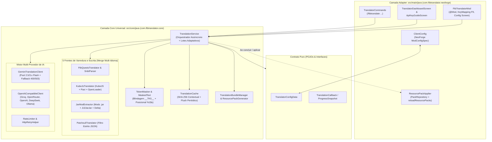
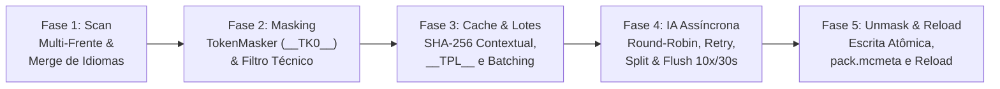

# Universal Modpack & Quests Auto-Translator (`ftbtranslator`) — Arquitetura e Funcionalidades

> [!NOTE]
> **Mod ID:** `ftbtranslator` | **Versão:** `1.0.0` | **Java:** `21` | **Loader Atual:** `NeoForge 1.21 / 1.21.1` (Arquitetura Multi-Loader Desacoplada pronta para Fabric, Quilt e Forge).

O **Universal Modpack & Quests Auto-Translator** é um mod *Client-Side* projetado para traduzir automaticamente qualquer modpack de Minecraft (de Inglês, Japonês, Chinês, Vietnamita, Coreano, etc.) para **Português do Brasil (`pt_br`)**, cobrindo **FTB Quests**, **KubeJS / Paxi / OpenLoader**, **Mods (`.jar` e sub-mods aninhados)** e **Livros de Guia do Patchouli**, além de permitir exportar e importar todas as traduções em um pacote `.zip` compartilhável sem necessidade de API Key para quem recebe.

---

## 1. Visão Geral da Arquitetura Multi-Loader

O projeto foi construído sobre uma separação física e lógica estrita em dois *Source Sets* no [`build.gradle`](build.gradle):



### 1.1. Isolamento de Classpath no Gradle (`sourceSets.core`)
No arquivo [`build.gradle`](build.gradle#L28-L55), o conjunto `sourceSets.core` compila **exclusivamente** com a biblioteca padrão do **Java 21** e `com.google.code.gson:gson:2.10.1`.
* **Regra de Isolamento:** Nenhuma classe dentro de `com.ftbtranslator.core.*` pode importar `net.minecraft.*`, `com.mojang.*` ou `net.neoforged.*`. Se alguém tentar adicionar um import do Minecraft no `core`, a task `:compileCoreJava` falha imediatamente em tempo de compilação.
* **Portabilidade Multi-Loader:** Graças a esse isolamento, **~90% do código do mod (25 classes do `core`) já é 100% compatível com Fabric, Quilt, Forge e NeoForge em qualquer versão moderna do Minecraft (1.18.2 a 1.21.4+)**. Para compilar para outro loader, basta reimplementar as 6 classes leves do pacote adaptador.

---

## 2. Estrutura de Diretórios e Módulos do Projeto

Todas as linhas abaixo respeitam o limite máximo de 85 colunas para leitura e exportação PDF:

```text
ftbtranslator/
├── build.gradle                           # NeoGradle 1.21.1 + sourceSets.core
├── gradle.properties                      # Java 21, NeoForge 21.1.219 e IDs
├── ARCHITECTURE_AND_FEATURES.md           # Documentação técnica do projeto
├── src/
│   ├── core/java/com/ftbtranslator/core/  # CAMADA CORE (100% Java 21 + Gson)
│   │   ├── ApiMode.java                   # Modos HTTP (GEMINI / OPENAI)
│   │   ├── CancellationToken.java         # Pausa e cancelamento cooperativo
│   │   ├── ContextPreset.java             # Presets (DEFAULT, TENSURA, TECH...)
│   │   ├── GamePaths.java                 # Caminhos da instância e detecção
│   │   ├── LogLevel.java                  # Níveis de log (INFO, WARN, ERROR)
│   │   ├── ProgressSnapshot.java          # Estado em tempo real para a GUI
│   │   ├── ProviderType.java              # Provedores (Gemini, Groq, Ollama...)
│   │   ├── TranslationCallback.java       # Interface assíncrona Core -> UI
│   │   ├── TranslationCancelledException.java # Exceção de cancelamento limpo
│   │   ├── TranslationReport.java         # Relatório consolidado de execução
│   │   ├── TranslationScope.java          # Escopos (QUESTS, KUBEJS, MODS...)
│   │   ├── TranslationService.java        # Orquestrador central do pipeline
│   │   ├── TranslatorConfigData.java      # POJO puro de configuração
│   │   ├── api/
│   │   │   ├── AiTranslationClient.java   # Contrato dos clientes HTTP de IA
│   │   │   ├── GeminiTranslationClient.java # Cliente Gemini + Pool + Fallback
│   │   │   ├── HttpRetryHelper.java       # Retry HTTP com Exponential Backoff
│   │   │   ├── OpenAiCompatibleClient.java# Cliente REST /v1/chat/completions
│   │   │   ├── PromptBuilder.java         # System Prompt enxuto e payload JSON
│   │   │   ├── RateLimiter.java           # Limitador RPM de janela deslizante
│   │   │   └── TranslationClientFactory.java # Fábrica de clientes por provedor
│   │   ├── bundle/
│   │   │   └── TranslationBundleManager.java # Export/Import .zip anti-ZipSlip
│   │   ├── cache/
│   │   │   ├── TranslationCache.java      # Cache SHA-256 contextual + flush
│   │   │   └── TranslationGlossary.java   # Glossário de traduções oficiais
│   │   ├── pack/
│   │   │   └── ResourcePackGenerator.java # Gerador pack.mcmeta (format 15..99)
│   │   ├── parser/
│   │   │   ├── ExistingTranslationHarvester.java # Reuso de traduções já instaladas
│   │   │   ├── FtbQuestsTranslator.java   # Frentes 1 e 2: FTB Quests (.snbt)
│   │   │   ├── JarModExtractor.java       # Frente 4: .jar + JIJ/JarJar + Delta
│   │   │   ├── JsonLangIO.java            # Leitura/escrita atômica de JSON
│   │   │   ├── KubeJsTranslator.java      # Frente 3: KubeJS, Paxi e OpenLoader
│   │   │   ├── PatchouliTranslator.java   # Frente 5: Livros guia do Patchouli
│   │   │   ├── PendingOutputTask.java     # Unidade de arquivo pendente
│   │   │   └── SnbtParser.java            # Parser SNBT com merge multi-idioma
│   │   └── text/
│   │       ├── MaskedText.java            # Texto mascarado + filtro técnico
│   │       └── TokenMasker.java           # Mascarador __TK0__ e %1$s posicional
│   ├── main/java/com/ftbtranslator/neoforge/ # ADAPTER NEOFORGE 1.21.1
│   │   ├── FtbTranslatorMod.java          # @Mod, atalho F9 e eventos Client
│   │   ├── ClientConfig.java              # Config TOML (ModConfigSpec)
│   │   ├── ResourcePackApplier.java       # Ativação automática do ResourcePack
│   │   ├── TranslatorCommands.java        # Comandos /ftbtranslate (Brigadier)
│   │   └── gui/
│   │       ├── TranslatorDashboardScreen.java # Painel gráfico principal (F9)
│   │       └── ApiKeyGuideScreen.java     # Guia passo a passo de API Key
│   └── coreTest/java/com/ftbtranslator/core/
│       └── EndToEndCoreTest.java          # Testes JUnit 5 de ponta a ponta
```

---

## 3. Pipeline Completo de Funcionamento (As 5 Frentes e 5 Fases)

Quando o usuário clica em **"Iniciar Tradução"** na [`TranslatorDashboardScreen`](src/main/java/com/ftbtranslator/neoforge/gui/TranslatorDashboardScreen.java) ou executa `/ftbtranslate start`, o método [`TranslationService.runSynchronously`](src/core/java/com/ftbtranslator/core/TranslationService.java#L152-L575) executa em uma thread daemon dedicada (`FTBTranslator-Worker`) seguindo **5 fases bem definidas**:



### Fase 1: Descoberta e Extração Multi-Frente (Scan + Merge Multi-Idioma)
1. O serviço carrega o [`TranslationCache`](src/core/java/com/ftbtranslator/core/cache/TranslationCache.java) configurado com o contexto temático ativo (`DEFAULT`, `TENSURA`, `TECH`, `MAGIC` ou `CUSTOM`).
2. O [`JarModExtractor.indexModJars`](src/core/java/com/ftbtranslator/core/parser/JarModExtractor.java#L60-L155) indexa todos os `.jar` de `mods/` (incluindo sub-mods aninhados em `META-INF/jars/*.jar` e `META-INF/jarjar/*.jar`), realizando **Merge Multi-Idioma por Prioridade** (`en_us` complementado por `ja_jp`, `zh_cn`, etc., para chaves ausentes ou vazias).
3. Em seguida, os scanners de cada frente habilitada ([`FtbQuestsTranslator`](src/core/java/com/ftbtranslator/core/parser/FtbQuestsTranslator.java), [`KubeJsTranslator`](src/core/java/com/ftbtranslator/core/parser/KubeJsTranslator.java), [`PatchouliTranslator`](src/core/java/com/ftbtranslator/core/parser/PatchouliTranslator.java) e [`JarModExtractor`](src/core/java/com/ftbtranslator/core/parser/JarModExtractor.java)) geram a lista de tarefas [`PendingOutputTask`](src/core/java/com/ftbtranslator/core/parser/PendingOutputTask.java).

### Fase 2: Mascaramento Determinístico (`TokenMasker`) e Filtro Técnico Local
1. Cada string extraída passa por [`TokenMasker.mask(String)`](src/core/java/com/ftbtranslator/core/text/TokenMasker.java#L54-L98), que substitui códigos de cor, tags do FTB Quests, macros do Patchouli, quebras de linha e placeholders Java por tokens `__TK0__`, `__TK1__`, etc.
2. Se a string possuir 2 ou mais placeholders não-indexados (`%s`, `%d`, `%f`), o `TokenMasker` converte-os automaticamente para a forma posicional (`%1$s`, `%2$d`, `%3$s`) para suportar inversões gramaticais na tradução.
3. O método [`MaskedText.hasTranslatableContent()`](src/core/java/com/ftbtranslator/core/text/MaskedText.java#L38-L106) filtra localmente strings puramente técnicas (IDs `namespace:item`, `snake_case`, URLs, números com unidades `100 FE/t`), resolvendo-as na hora sem gastar tokens de IA.

### Fase 3: Desduplicação (`__TPL__`), Consulta ao Cache SHA-256 e Montagem de Lotes Adaptativos
1. O serviço consulta o [`TranslationCache`](src/core/java/com/ftbtranslator/core/cache/TranslationCache.java) usando a chave isolada por contexto: `SHA-256(contextPreset + "|" + customPromptHash + "|" + sourceText)`.
2. Strings não encontradas diretamente são verificadas pelo seu template mascarado (`__TPL__` + `masked.masked()`) e agrupadas em `originalsByTemplate`. Assim, frases idênticas que diferem apenas nas cores ou macros são traduzidas **uma única vez**.
3. Qualquer arquivo cujas strings já estejam 100% resolvidas pelo cache é gravado em disco imediatamente antes mesmo de iniciar chamadas HTTP.
4. Os templates restantes são agrupados por [`TranslationService.buildAdaptiveBatches`](src/core/java/com/ftbtranslator/core/TranslationService.java#L525-L580) em lotes de até **80 strings curtas** (ou até **15 strings longas** `> 300` caracteres, respeitando o teto de caracteres por lote).

### Fase 4: Tradução Assíncrona em Lotes (Round-Robin, Rate-Limiter, Split-on-Timeout e Flush Periódico)
1. Para cada lote, o cliente de IA ativo ([`GeminiTranslationClient`](src/core/java/com/ftbtranslator/core/api/GeminiTranslationClient.java) ou [`OpenAiCompatibleClient`](src/core/java/com/ftbtranslator/core/api/OpenAiCompatibleClient.java)) envia um objeto JSON indexado (`{"0": "...", "1": "..."}`) acompanhado do System Prompt temático.
2. Em caso de timeout ou resposta truncada em lotes grandes, [`translateBatchResilient`](src/core/java/com/ftbtranslator/core/TranslationService.java#L480-L523) divide o lote automaticamente ao meio (`left` e `right`) e traduz cada metade recursivamente.
3. Para evitar *Disk Thrashing* em caches grandes (15–30 MB), [`cache.flushIfDueAfterBatch()`](src/core/java/com/ftbtranslator/core/cache/TranslationCache.java#L156-L169) grava o arquivo `cache_pt_br.json` em disco apenas a cada **10 lotes concluídos** ou quando decorridos **30 segundos** desde o último save — e o bloco `finally` do `TranslationService` executa obrigatoriamente `cache.flush()` ao concluir, pausar, cancelar ou falhar.

### Fase 5: Desmascaramento Validado (`unmask`), Gravação Atômica, Resource Pack e Auto-Reload
1. Cada tradução recebida passa por [`TokenMasker.unmask(translated, masked)`](src/core/java/com/ftbtranslator/core/text/TokenMasker.java#L105-L141), que verifica se 100% dos marcadores `__TK0__..__TKn__` foram preservados e restaura os códigos originais de cada string.
2. Ao final de cada lote, qualquer [`PendingOutputTask`](src/core/java/com/ftbtranslator/core/parser/PendingOutputTask.java) cujas strings pendentes tenham zerado é gravada incrementalmente em disco via escrita atômica (`.tmp` -> `ATOMIC_MOVE`).
3. O [`ResourcePackGenerator.ensurePackMcmeta`](src/core/java/com/ftbtranslator/core/pack/ResourcePackGenerator.java) garante o `pack.mcmeta` válido em `resourcepacks/AutoTranslated_Pack_PTBR/`, e a camada NeoForge aciona [`ResourcePackApplier.applyAndReload`](src/main/java/com/ftbtranslator/neoforge/ResourcePackApplier.java) na Main Client Thread.

---

## 4. As 5 Frentes de Tradução e Comportamento Singleplayer vs. Multiplayer

### Frente 1: FTB Quests — Arquivos de Idioma (`config/ftbquests/quests/lang/`)
* **Classes:** [`FtbQuestsTranslator.java`](src/core/java/com/ftbtranslator/core/parser/FtbQuestsTranslator.java) + [`SnbtParser.java`](src/core/java/com/ftbtranslator/core/parser/SnbtParser.java).
* **Merge Multi-Idioma:** Carrega todos os arquivos `<locale>.snbt` (e subpastas `lang/<locale>/*.snbt`) na ordem de `sourceLanguagePriority` (`en_us`, `ja_jp`, `zh_cn`...) via [`SnbtParser.mergeLangSnbtDocuments`](src/core/java/com/ftbtranslator/core/parser/SnbtParser.java#L92-L163), preenchendo chaves ausentes ou em branco no `en_us.snbt` com os valores dos idiomas secundários antes de gerar `pt_br.snbt`.

### Frente 2: FTB Quests — Capítulos e Tabelas Hardcoded (`chapters/*.snbt` e `reward_tables/*.snbt`)
* **Classes:** [`FtbQuestsTranslator.java`](src/core/java/com/ftbtranslator/core/parser/FtbQuestsTranslator.java) + [`SnbtParser.extractHardcodedQuestSpans`](src/core/java/com/ftbtranslator/core/parser/SnbtParser.java#L256-L290).
* **Funcionamento:** Extrai textos diretos nos campos `"title"`, `"subtitle"` e `"description"`, ignorando referências de chave no formato `{chave.de.traducao}`. Cria backup automático único em `config/ftbquests/quests_backup_original/` antes de modificar qualquer arquivo.

### Frente 3: KubeJS, Paxi e OpenLoader (`kubejs/assets/*/lang/`, etc.)
* **Classe:** [`KubeJsTranslator.java`](src/core/java/com/ftbtranslator/core/parser/KubeJsTranslator.java).
* **Funcionamento:** Varre `kubejs/assets/*/lang/`, `config/paxi/resourcepacks/*/assets/*/lang/` e `openloader/resources/*/assets/*/lang/`. Combina todos os `<locale>.json` da pasta por ordem de prioridade, desduplica contra os `.jar` de `mods/` e grava `pt_br.json`.

### Frente 4: Extrator de Mods (`.jar`), Sub-Mods Aninhados e Delta Translation
* **Classe:** [`JarModExtractor.java`](src/core/java/com/ftbtranslator/core/parser/JarModExtractor.java).
* **Funcionamento:** Lê todos os `.jar` de `mods/` (somente leitura via `ZipFile`) e `.jar` aninhados (`META-INF/jars/*.jar` do Fabric/Quilt e `META-INF/jarjar/*.jar` do NeoForge/Forge). Realiza merge multi-idioma entre os arquivos `lang/<locale>.json` do mod e aplica **Delta Translation** quando `skipAlreadyTranslatedMods` está ativo, traduzindo apenas as chaves ausentes no `pt_br.json` original e salvando em `resourcepacks/AutoTranslated_Pack_PTBR/assets/<namespace>/lang/pt_br.json`.

### Frente 5: Livros de Guia do Patchouli (`patchouli_books`)
* **Classe:** [`PatchouliTranslator.java`](src/core/java/com/ftbtranslator/core/parser/PatchouliTranslator.java).
* **Funcionamento:** Varre livros dentro de `mods/*.jar`, `kubejs/assets/*/patchouli_books/` e na pasta raiz `patchouli_books/`, mesclando entradas e campos faltantes entre idiomas (`en_us`, `ja_jp`, `zh_cn`) via [`mergePatchouliJsonDocuments`](src/core/java/com/ftbtranslator/core/parser/PatchouliTranslator.java#L313-L364). Traduz estritamente os campos textuais (`"name"`, `"subtitle"`, `"title"`, `"description"`, `"landing_text"`, `"text"`, `"header"`), preservando intocados todos os campos técnicos (`"type"`, `"icon"`, `"category"`, `"advancement"`, `"flag"`, `"recipe"`, `"item"`).

### 4.1. Comportamento em Singleplayer vs. Multiplayer (Servidores Dedicados)

| Frente de Tradução | Singleplayer / LAN | Multiplayer (Servidor Dedicado) | Explicação Técnica |
| :--- | :---: | :---: | :--- |
| **Frente 1:** FTB Quests (`lang/*.snbt`) | 100% Client-Side | **100% Client-Side** | Carregado localmente pelo cliente a partir de `lang/pt_br.snbt`. |
| **Frente 2:** FTB Quests (`chapters/*.snbt`) | 100% Local | **Requer Bundle no Servidor** | Em servidores dedicados, o FTB Quests do servidor sincroniza os capítulos com os clientes no login. Para capítulos hardcoded ficarem traduzidos no Multiplayer, o admin do servidor também deve aplicar os arquivos de `config/ftbquests/` gerados no `Traducao_Modpack_PTBR.zip`. |
| **Frente 3:** KubeJS / Paxi / OpenLoader | 100% Client-Side | **100% Client-Side** | Arquivos `lang/pt_br.json` são lidos apenas pelo cliente. |
| **Frente 4:** Mods (`.jar`) | 100% Client-Side | **100% Client-Side** | Aplicado via Resource Pack local (`AutoTranslated_Pack_PTBR`). |
| **Frente 5:** Livros do Patchouli | 100% Client-Side | **100% Client-Side** | Carregado via Resource Pack local e/ou `patchouli_books/*/pt_br/`. |

---

## 5. Blindagem de Formatação (`TokenMasker`) e Otimizações de Tokens/Velocidade

### 5.1. Blindagem Determinística (`TokenMasker` e `MaskedText`)
Antes de qualquer string ser enviada para a IA, [`TokenMasker.mask(String)`](src/core/java/com/ftbtranslator/core/text/TokenMasker.java#L54-L98) substitui padrões técnicos por placeholders curtos (`__TK0__`, `__TK1__`, etc.):

| Categoria Protegida | Padrões e Exemplos Capturados (Substituídos por `__TK0__`, `__TK1__`...) |
| :--- | :--- |
| **Tags FTB Quests** | `{@pagebreak}`, `{image:tensura:textures/gui/icon.png width:100 height:100}`, `{chave.referencia}` |
| **Macros Patchouli** | `$(item)`, `$(l:basics/intro)`, `$(#ff0000)`, `$()`, `$(br2)` |
| **Placeholders Java** | `%s`, `%d`, `%f`, `%1$s`, `%2$d`, `%.1f`, `%%` |
| **Formatação Minecraft** | `&0` a `&9`, `&a` a `&f`, `&k` a `&r`, `§0` a `§r`, Hex `&#RRGGBB` e `§x§R§R§G§G§B§B` |
| **Quebras de Linha** | `\n`, `\r\n`, `\t` (preserva exatamente a estrutura de linhas original) |

* **Conversão Automática para Placeholders Posicionais (`%1$s`, `%2$d`):** Quando uma string possui 2 ou mais placeholders não-indexados (ex: `"%s killed %s"` ou `"%s gave %d items to %s"`), o `TokenMasker` converte automaticamente os valores dos tokens para a sintaxe posicional do Java (`%1$s`, `%2$d`, `%3$s`). Assim, mesmo que a IA inverta a ordem de `__TK0__` e `__TK1__` na frase em português (ex: `"__TK1__ foi derrotado por __TK0__"` -> `"%2$s foi derrotado por %1$s"`), o `String.format` do Minecraft injeta as variáveis nas posições corretas.
* **Validação Estrita na Volta (`TokenMasker.unmask`):** Se a IA omitir, corromper ou inventar qualquer marcador `__TKn__`, a tradução daquele item é descartada com segurança e o texto original é mantido.

### 5.2. Resiliência e Otimizações de Velocidade/Tokens
1. **Merge Multi-Idioma e Desduplicação Cruzada `KubeJS` ↔ `Mods (.jar)`:** Combina chaves de múltiplos idiomas (`en_us` + `ja_jp` + `zh_cn`) sem perder textos parciais e evita traduzir a mesma chave duas vezes entre o KubeJS e os `.jar`.
2. **Desduplicação Universal por Template Mascarado (`__TPL__`):** Frases idênticas em mods distintos que só mudam códigos de cor ou macros geram o mesmo template mascarado e são traduzidas **uma única vez** pela IA.
3. **Isolamento de Contexto + Prevenção de Disk Thrashing no `TranslationCache`:**
   * O hash de cache inclui o contexto ativo (`SHA-256(contextPreset + "|" + customPromptHash + "|" + sourceText)`), garantindo que trocar de `DEFAULT` para `TENSURA` (ou `TECH`/`MAGIC`/`CUSTOM`) gere traduções fiéis ao novo glossário.
   * O cache controla `dirtyCount` e `lastSaveTimestamp`, salvando no disco apenas a cada **10 lotes concluídos** (ou a cada **30 segundos**) durante o loop e executando `cache.flush()` obrigatoriamente no bloco `finally` do `TranslationService`.
4. **Pool Oficial Estável Gemini + Fallback Imediato de `thinkingConfig` (HTTP 400):**
   * O [`GeminiTranslationClient`](src/core/java/com/ftbtranslator/core/api/GeminiTranslationClient.java) prioriza os modelos oficiais estáveis (`gemini-2.5-flash`, `gemini-2.5-flash-lite`, seguidos por `gemini-3.1-flash-lite`, `gemini-3.5-flash-lite`, `gemini-3.5-flash` e `gemini-2.0-flash`) em rodízio *Round-Robin* com `RateLimiter` independente por modelo.
   * Caso algum endpoint/modelo rejeite o bloco `"thinkingConfig": {"thinkingLevel": "MINIMAL"}` com `HTTP 400 Bad Request`, o cliente marca a flag de incompatibilidade em `thinkingConfigDisabledModels` para aquele modelo e **reenvia imediatamente na mesma chamada** sem o bloco `thinkingConfig`.

---

## 6. Interface Gráfica (GUI), Comandos e Sistema de Bundle (`.zip`)

* **Atalho `F9` e Menu `Mods -> Config` ([`TranslatorDashboardScreen`](src/main/java/com/ftbtranslator/neoforge/gui/TranslatorDashboardScreen.java)):** Permite alternar provedor (`Google Gemini`, `Groq`, `OpenRouter`, `OpenAI`, `Ollama Local`), colar/testar a API Key, abrir o guia passo a passo ([`ApiKeyGuideScreen`](src/main/java/com/ftbtranslator/neoforge/gui/ApiKeyGuideScreen.java)), ativar/desativar as 4 frentes, escolher o Contexto (`Padrão` por default, ou `Tensura` auto-detectado quando o mod Tensura está presente), pausar/retomar/cancelar com trava de segurança dos botões de configuração durante a execução, e acionar **Exportar** / **Importar**.
* **Bundle Compartilhável (`exports/Traducao_Modpack_PTBR.zip`):** Compacta e importa todas as traduções e o Resource Pack `AutoTranslated_Pack_PTBR` com validação anti-*Zip-Slip* e recarregamento automático sem precisar de API Key.
* **Comandos Client-Side (`/ftbtranslate`):** Subcomandos `start [all|quests|kubejs|mods|patchouli]`, `pause`, `cancel`, `status`, `reload`, `export` e `import [caminho]`.

---

## 7. Guia Rápido para Portar para Outros Loaders (Fabric / Forge)

1. **Mantenha `src/core/java/com/ftbtranslator/core/` 100% intacto:** Nenhuma classe de parser, cache, extrator de `.jar`, Patchouli, FTB Quests ou IA precisa ser alterada. O `ResourcePackGenerator` já emite `"supported_formats": {"min_inclusive": 15, "max_inclusive": 99}` no `pack.mcmeta`, garantindo compatibilidade de pacotes da 1.20 até a 1.21.4+.
2. **Crie apenas o pacote adaptador do loader alvo** (ex: `com.ftbtranslator.fabric`) substituindo as 6 classes leves de integração (`ClientModInitializer`, `KeyBindingHelper`, `ClientCommandRegistrationCallback`, persistência de config e `Screen`).

---

## 8. Roadmap de Evolução Futura (Próximas Etapas Planejadas)

### 8.1. Reformulação de UX/UI Orientada ao Usuário Leigo
* Reestruturação visual da [`TranslatorDashboardScreen`](src/main/java/com/ftbtranslator/neoforge/gui/TranslatorDashboardScreen.java) com foco em usabilidade imediata e adição de **Tooltips explicativos ao passar o mouse (*Hover Tooltips*)** sobre cada opção (`FTB Quests`, `KubeJS`, `Mods .jar`, `Patchouli`, `Delta Translation`, `Contexto`), explicando em linguagem simples e acessível o que cada tecnologia representa dentro do jogo para que jogadores sem conhecimento técnico saibam exatamente o que selecionar.

### 8.2. Motor de Cache de Segunda Geração e Otimização Extrema de Tokens
* **Implementado — Glossário Oficial:** os `pt_br.json` que os próprios mods já trazem (tradução humana) alimentam o [`TranslationGlossary`](src/core/java/com/ftbtranslator/core/cache/TranslationGlossary.java). Textos idênticos em qualquer frente são resolvidos sem IA (validando placeholders), e termos curtos encontrados no lote são injetados no prompt para manter a terminologia oficial. Arquivos `pt_br` que são só cópia do `en_us` são ignorados; divergências são resolvidas por votação.
* **Implementado — Reuso de traduções da comunidade:** o [`ExistingTranslationHarvester`](src/core/java/com/ftbtranslator/core/parser/ExistingTranslationHarvester.java) alimenta o glossário com (1) os `pt_br.json` de pacotes de tradução em `resourcepacks/` (pasta ou `.zip`, exceto o pacote gerado), pareados por chave com o `en_us` dos `.jar`, e (2) o `pt_br.snbt` das missões já instalado, pareado por chave (e por linha, nas descrições) com o `en_us.snbt` **antes** de ser reescrito. Assim, só textos ainda não traduzidos vão para a IA e a tradução existente é preservada.
* **Implementado — Import seguro:** importar um bundle `.zip` é recusado enquanto uma tradução está rodando, evitando que o flush do cache em memória sobrescreva o cache importado.
* Pesquisa e implementação de técnicas avançadas de aproveitamento de cache — incluindo pré-aquecimento de dicionários com termos recorrentes de mods de Minecraft, compressão de payload JSON em trânsito e armazenamento incremental — visando reduzir ainda mais o consumo de tokens de IA e acelerar drasticamente a primeira tradução de modpacks gigantes.
